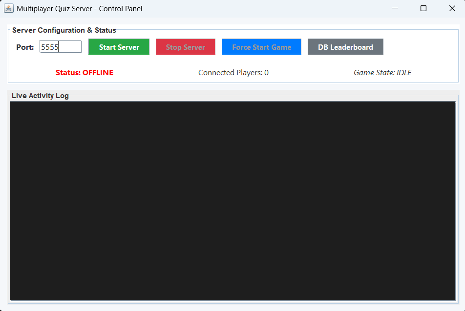
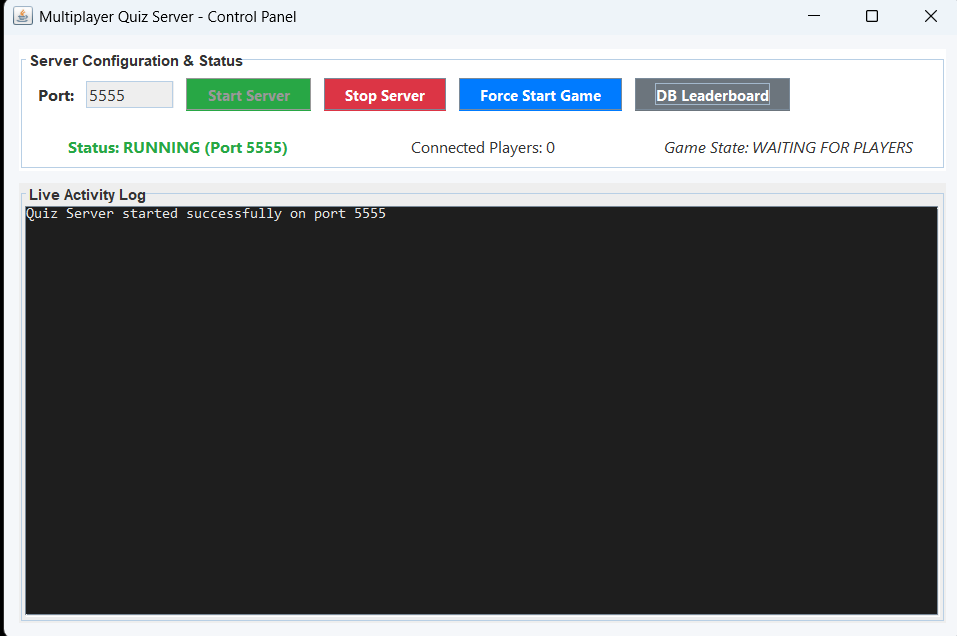
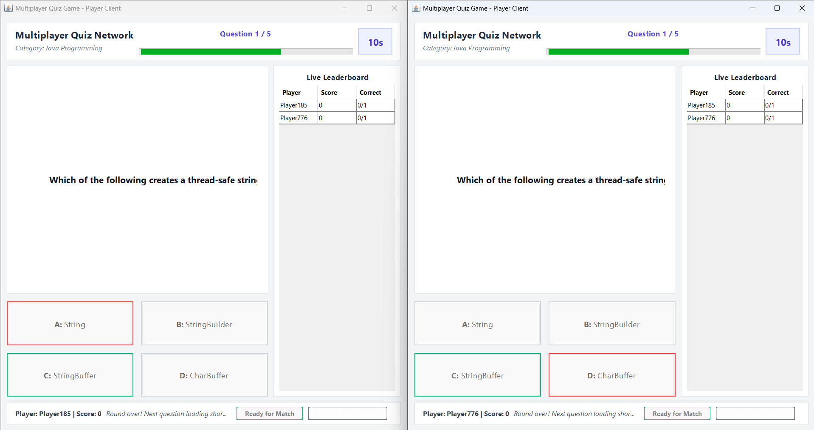
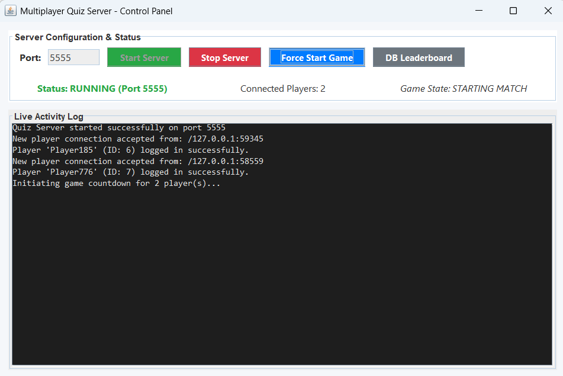
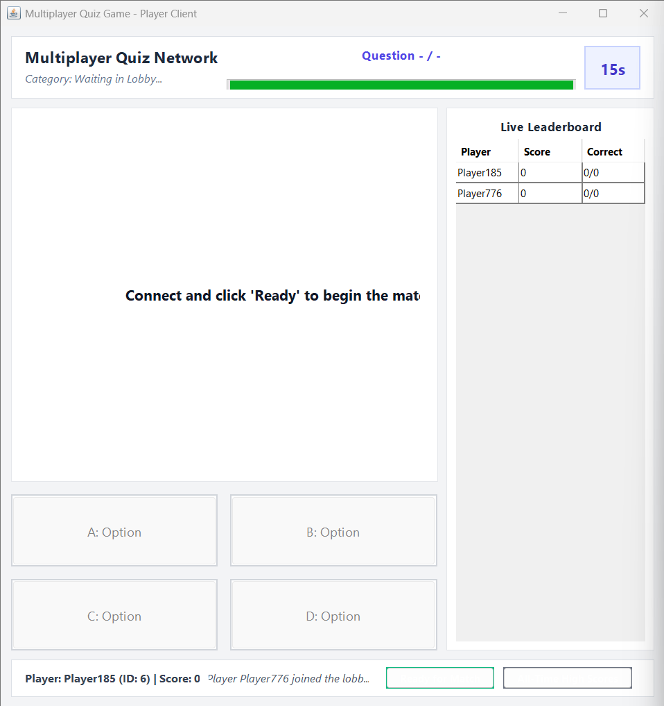
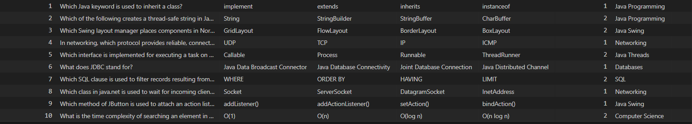
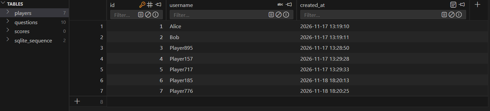

# Multiplayer Quiz Game

A Java-based multiplayer quiz application in which players connect to a central server and compete by answering the same quiz questions. The project uses **Java Swing** for the graphical interfaces, **TCP sockets** for client-server communication, and **SQLite** for persistent data.

## Features

- **Server control panel** to start and stop the quiz server.
- **Configurable server port** (the screenshots show port `5555`).
- **Player login and lobby** for connecting multiple clients.
- **Two-player multiplayer matches** with a shared question flow.
- **Timed questions** with a visible countdown.
- **Live leaderboard** showing player scores and correct answers.
- **SQLite database** for player records, quiz questions, and scores.
- **Question categories**, including Java Programming, Java Swing, Networking, Java Threads, Databases, SQL, and Computer Science.

## Screenshots

### Server control panel

The server can be started from the control panel. Its status, connected-player count, game state, and activity log are displayed here.

| Server offline | Server running |
|---|---|
|  |  |

### Multiplayer gameplay

Two clients can join the same match. Both see the current question, answer options, timer, and live leaderboard.

### Match startup and lobby

The server log shows incoming client connections and the match-start process.

A connected player waits in the lobby and can use **Ready for Match** when available.

The server returns to its waiting state when no players are connected.

### SQLite question bank and player records

The question bank contains multiple-choice questions, four answer options, the correct-option value, and a category.

The SQLite `players` table stores player IDs, usernames, and account creation timestamps.

Another view of the question bank:

## Technology Stack

| Component | Technology |
|---|---|
| Programming language | Java |
| Desktop GUI | Java Swing |
| Networking | TCP sockets (`ServerSocket` / `Socket`) |
| Database | SQLite |
| Database connectivity | JDBC |

## Database

The screenshots show the following SQLite tables:

- `players` — registered player information.
- `questions` — quiz questions, options, correct answers, and categories.
- `scores` — score records.
- `sqlite_sequence` — SQLite's internal sequence tracking table.

## Running the Project

> The exact build command and Java main-class names depend on the source-code layout. The steps below describe the expected run order without assuming a particular build tool.

1. Install a Java Development Kit (JDK).
2. Make sure the SQLite JDBC driver is available on the project's classpath.
3. Open the project in your Java IDE, or compile it using the build configuration included with your source code.
4. Start the **Quiz Server** application.
5. Enter the server port (the demonstrated port is `5555`) and click **Start Server**.
6. Launch the **Player Client** on each player's computer.
7. Connect each client to the server's IP address and port, then log in with a username.
8. Once the required players have joined, use the ready/match controls to begin playing.

### Connecting from another computer

- Run the server on the host computer.
- Find the host computer's local network IP address.
- In each client, use that IP address and the same port configured in the server.
- Ensure both computers are on a network that allows them to communicate.
- Allow the Java application through the host computer's firewall, or create an inbound rule for the configured TCP port if required.

`127.0.0.1` (localhost) only works for clients running on the same computer as the server. For another computer, use the server computer's LAN IP address.

## Project Notes

- The screenshots demonstrate a server using port `5555` and two connected players.
- The displayed gameplay example contains five questions, with a countdown shown for each question.
- The database screenshots show ten question records.
- This README documents the visible application and database features. Add your actual package names, main classes, build instructions, and any deployment details once those are finalized.

## Future Improvements

- Add configurable match size and question count.
- Add more quiz categories and difficulty levels.
- Improve reconnect handling if a player loses their network connection.
- Add a match history screen and per-player statistics.
- Package the server and client as runnable JAR files.

## License

Add a license before distributing or reusing this project publicly.
